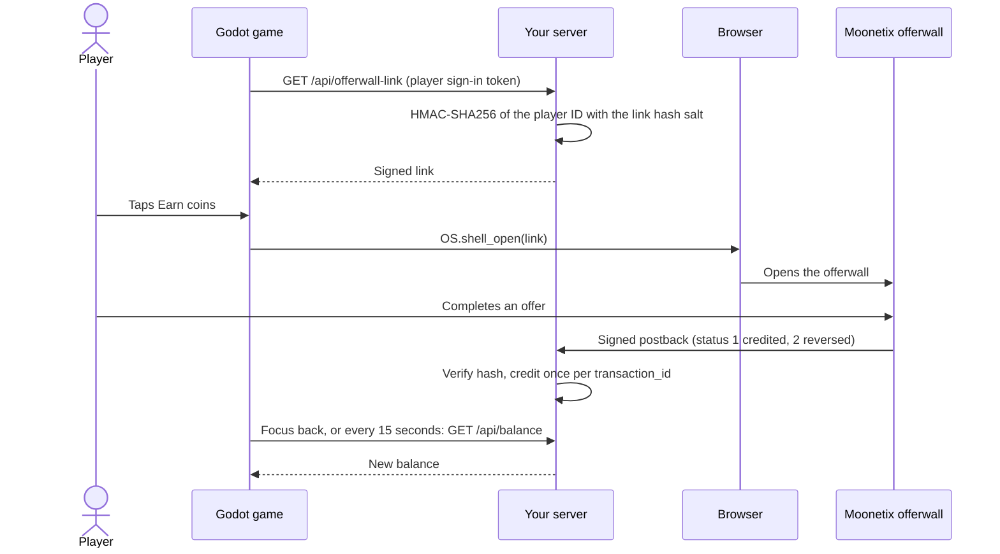

# Moonetix offerwall: Godot 4 example

**Add an offerwall to a Godot 4 game without an SDK: your server signs the link, GDScript opens it, postbacks credit the coins.**

[](https://github.com/moonetix/offerwall-godot/actions/workflows/ci.yml)
[](https://moonetix.com)
[](LICENSE)
[](https://docs.moonetix.com/offerwall-link)
[](https://moonetix.com/register?from=github-offerwall-godot)
[](https://moonetix.com/academy/integrations/godot-offerwall)
[](server/)

A minimal Godot 4 project (Earn coins button, coin HUD) and a Node.js server that signs the [Moonetix](https://moonetix.com) offerwall link, credits coins from postbacks and returns the balance. Moonetix is an affiliate network: players earn your currency by completing offers, and you earn per completed offer. To get an App ID and keys, [sign up free](https://moonetix.com/register?from=github-offerwall-godot).

## Why a link and not an SDK

`HTTPRequest` and `OS.shell_open` are core Godot APIs, so the same button runs on Android, iOS, Windows, macOS, Linux and web exports, and there is no plugin to keep up with Godot releases.

Nothing secret ships in the export either. The link hash salt and the postback key stay on the server; the game holds a random sign-in token and opens a link it got from your server. The server credits each `transaction_id` once and reverses exactly what it credited, and its 22 tests use real Moonetix postbacks, tampered ones included.

## Sequence



## Setup

You need Node.js 22.13 or later, Godot 4.3 or newer, and an approved Moonetix app.

**1. Start the server**

```bash
git clone https://github.com/moonetix/offerwall-godot.git
cd offerwall-godot/server
cp .env.example .env      # put your App ID, link hash salt and postback secret key in .env
npm start                 # listens on PORT (default 3000)
```

| Variable | Required | Default | Purpose |
| --- | --- | --- | --- |
| `MOONETIX_APP_ID` | yes | | App ID from Offerwalls, your offerwall, Integration |
| `MOONETIX_LINK_SALT` | yes | | Link hash salt from the same page. Server only. |
| `MOONETIX_POSTBACK_KEY` | yes | | Postback secret key from the Postback page. Server only. |
| `CORS_ORIGIN` | no | off | Exact origin of a web export on another domain, for example `https://play.example.com` |
| `PORT` | no | `3000` | HTTP port |
| `DATABASE_PATH` | no | `./data.sqlite` | SQLite file for players, balances and transactions |
| `CURRENCY_NAME` | no | `Coins` | Currency label returned by `/api/balance` |

The game side has two constants: `SERVER_URL` in `godot/scripts/player_session.gd` (default `http://127.0.0.1:3000`) and `POLL_SECONDS` in `godot/scripts/wallet.gd` (default 15).

Put the server behind https and save this postback URL on the Postback page:

```text
https://YOUR_HOST/moonetix/postback?user={user_id}&tx={transaction_id}&event={event_id}&status={status}&reward={reward}&payout={payout}&offer={offer_name}&hash={hash}
```

**2. Open the Godot project**

1. In the Godot Project Manager, choose Import and select `godot/project.godot`.
2. Set `SERVER_URL` in [`godot/scripts/player_session.gd`](godot/scripts/player_session.gd) to your server. Use https for anything but a desktop run on your own machine.
3. Press Play. Confirm the age check, then press Earn coins. The offerwall opens in the default browser.

For an Android export, enable the INTERNET permission in the export preset, or Android blocks every request. Android and iOS also refuse plain `http://` by default.

## Step by step

1. On first launch the game asks the player to confirm they are 16 or older. `PlayerSession` then creates a guest player on your server and saves only a random sign-in token in `user://`.
2. `EarnButton` asks `/api/offerwall-link` for the signed link ahead of time. The server picks the player from the sign-in token, never from a field the game sends, and signs the player ID with the link hash salt.
3. When the player presses Earn coins, the button checks that the link starts with `https://wall.moonetix.com/` and calls `OS.shell_open`. It opens the link right in the pressed handler, because a web export uses `window.open`, which browsers allow only in direct response to a click.
4. The player completes an offer. Moonetix calls `/moonetix/postback`. The server checks the hash first, credits status 1 once per `transaction_id`, takes the stored amount back on status 2, and answers 200 only after the change is saved.
5. `Wallet` reloads the balance on `NOTIFICATION_APPLICATION_FOCUS_IN` and every 15 seconds, because some offers credit minutes later.

| Path | Purpose |
| --- | --- |
| `godot/scripts/earn_button.gd` | Fetches the signed link, opens it, hides itself in Steam builds |
| `godot/scripts/wallet.gd` | Autoload. Polls the balance from your server. |
| `godot/scripts/player_session.gd` | Autoload. Demo sign-in. Replace with your own accounts. |
| `godot/scripts/main.gd`, `godot/main.tscn` | Coin HUD and age check |
| `server/src/moonetix.js` | Signed link, postback hash, exact amounts |
| `server/src/postback.js` | Postback handler |
| `server/src/store.js` | SQLite players, balances, transactions |
| `server/src/server.js` | HTTP routes and CORS |

The guest sign-in is only here so the example runs on its own. In your game, let the server take the player from your existing login, and use the account ID your wallet uses. Do not use `OS.get_unique_id()`: it changes on reinstall.

## What keeps balances correct

- The link hash salt and the postback secret key are read from environment variables on the server. Never sign the link in GDScript: a Godot export can be unpacked.
- The link belongs to the player of the sign-in token. A `user_id` the game sends is ignored.
- The postback hash is checked with a constant-time comparison before anything else. A missing hash gets 400, a wrong one 403.
- `transaction_id` is the primary key of the transactions table, so a retry cannot credit twice. The credit and the balance change run in one database transaction.
- A reversal subtracts the stored amount, only for a transaction that was credited to the same player. Balances can go below zero after a reversal; say in your terms that rewards can be taken back.
- The game never adds coins when the browser closes. Only a verified postback does.
- CORS is off unless `CORS_ORIGIN` is set, and then it allows that one origin only.
- Only a SHA-256 hash of each sign-in token is stored. Amounts are integers in millionths of a coin, so `0.375` adds up exactly.

## Export targets and store rules

- **Steam:** Valve does not support advertising models in Steam games and asks developers not to reward players for engaging with ads, so an offerwall does not belong in a Steam build. Create a separate export preset with the custom feature tag `steam` and leave the earn screen out of it. `earn_button.gd` also removes itself when `OS.has_feature("steam")` is true. See [Can you put ads in a Steam game?](https://moonetix.com/academy/monetization/ads-in-steam-games)
- **Console stores** have their own certification rules. Check them before you ship an earn screen.
- **Web game portals** such as CrazyGames, Poki and GameDistribution allow only their own ad SDK in the build you give them. Keep the earn button in the build you host yourself. See [How to monetize an HTML5 web game](https://moonetix.com/academy/monetization/monetize-html5-web-game).
- **Google Play and the App Store:** never reward ratings or reviews, and keep the offerwall optional.
- Rewards are only for completed offers, never for invites, likes, reviews or other engagement. Players must be 16 or older, with a parent's permission under 18.

## Server tests

```bash
cd server
npm test
```

Runs offline with fake keys, against an in-memory database. Covered:

- that the signed link is identical to the link the Moonetix code builds for the same test keys, for the signed-in player only;
- that a player is created only after the 16+ confirmation, and that only a hash of the sign-in token is stored;
- real postbacks produced by the Moonetix postback code (`server/test/fixtures/moonetix-vectors.json`): credit, retry, the same credit 10 times at once, decimal rewards, reversal, repeated reversal, a credit after its reversal, a reversal for another player, a `test_` reversal that was never credited, unknown players, tampered, wrongly signed and unsigned postbacks, and a storage failure that answers 500;
- that CORS answers only the configured web export origin.

The test values are fake: app ID `demoapp0000000000000001`, link salt `test_link_salt_not_secret`, postback key `test_postback_key_not_secret`. The GDScript is not run by these tests. Open the project in Godot to try it.

To test the running server from the outside, create a player (press Play once, or `curl -X POST http://127.0.0.1:3000/api/players -H 'Content-Type: application/json' -d '{"age_confirmed":true}'`) and run [postback-tester](https://github.com/moonetix/postback-tester). It signs postbacks the way Moonetix does and sends a credit and its retry, three kinds of reversal, four forged or unsigned postbacks and five parallel copies of one credit:

```bash
export MOONETIX_POSTBACK_KEY=your-postback-secret-key   # same value as in server/.env
npx github:moonetix/postback-tester --preset moonetix \
  'http://127.0.0.1:3000/moonetix/postback?user={user_id}&tx={transaction_id}&event={event_id}&status={status}&reward={reward}&payout={payout}&offer={offer_name}&hash={hash}' --user 1
```

## Try it against Moonetix

1. Run the game and confirm the age check. The HUD shows your player ID, 1 on a fresh database.
2. In the dashboard, open Offerwalls, your offerwall, Integration. Under Integration status, use Check a link, then Test a link with user ID `1`, and compare it with the link your server returns. They must match, apart from the `sub1=godot` tracking value.
3. Press Earn coins in a debug export on every target you ship. The offerwall should open, not the Link not valid page.
4. Click **Send a test postback** with user ID `1` and status 1. You can also send one from the Postback page. The balance goes up once when the game gets focus back.
5. A status 2 test gets a new `test_` transaction ID that was never credited, so the server answers 200 and changes nothing.
6. Test from a normal home or mobile connection. The offerwall blocks VPNs, proxies, Tor and data center networks.
7. Export the Steam preset and confirm the earn button is gone. Before launch, remove the test rewards from your test account.

## Common problems

| Symptom | Cause |
| --- | --- |
| `node: .env: not found` or `Missing environment variables: ...` | Copy `server/.env.example` to `server/.env` and fill in the three Moonetix values. |
| "Could not reach the game server. Try again later." | `SERVER_URL` is wrong for this device. `127.0.0.1` is the device itself: the Android emulator reaches your computer at `http://10.0.2.2:3000`, a phone needs your computer's LAN address or a public https host. Also check the INTERNET permission and the plain `http://` block on mobile. |
| "Offers are not available right now." | `/api/offerwall-link` failed or returned something other than a `https://wall.moonetix.com/` link. A 401 clears the saved token and shows the age check again. |
| Web export: requests fail with a CORS error | Set `CORS_ORIGIN` to the exact origin of the page, scheme and port included, no trailing path. |
| Postback answers 403 `invalid hash` | `MOONETIX_POSTBACK_KEY` does not match the Postback page, or a proxy changed the query string. |
| Postback answers 200 `ignored: unknown user` | The user ID is not a numeric player ID, for example `test_user` from a dashboard test. |

## References

- Guide: [How to add an offerwall to a Godot game](https://moonetix.com/academy/integrations/godot-offerwall)
- Guide: [How to monetize a Godot game](https://moonetix.com/academy/monetization/monetize-godot-game)
- Moonetix for games: [moonetix.com/industries/games](https://moonetix.com/industries/games). Website integration: [moonetix.com/integrations/website](https://moonetix.com/integrations/website)
- Docs: [Offerwall link](https://docs.moonetix.com/offerwall-link), [Postbacks](https://docs.moonetix.com/postbacks), [Credits and reversals](https://docs.moonetix.com/credits-and-reversals), [Testing](https://docs.moonetix.com/testing)
- Free tools: [Offerwall link builder](https://moonetix.com/tools/offerwall-link-builder) and [Postback hash checker](https://moonetix.com/tools/postback-hash-checker)

## Apply as a publisher

**Sign up free at https://moonetix.com/register?from=github-offerwall-godot.** We review each application by hand. Once approved, add the game as an app, choose the coin name and rate, and put the App ID, link hash salt and postback key in `server/.env`.

## More Moonetix examples

- **Start here:** [awesome-offerwalls](https://github.com/moonetix/awesome-offerwalls), [offerwall-postback-handlers](https://github.com/moonetix/offerwall-postback-handlers)
- **Games:** [offerwall-unity-example](https://github.com/moonetix/offerwall-unity-example), [offerwall-html5-game](https://github.com/moonetix/offerwall-html5-game), [moonetix-unity](https://github.com/moonetix/moonetix-unity)
- **Mobile:** [moonetix-android-sdk](https://github.com/moonetix/moonetix-android-sdk), [moonetix-ios-sdk](https://github.com/moonetix/moonetix-ios-sdk), [moonetix-flutter](https://github.com/moonetix/moonetix-flutter), [moonetix-react-native](https://github.com/moonetix/moonetix-react-native), [offerwall-flutter-example](https://github.com/moonetix/offerwall-flutter-example), [offerwall-react-native-example](https://github.com/moonetix/offerwall-react-native-example)
- **Web and backends:** [offerwall-nextjs-starter](https://github.com/moonetix/offerwall-nextjs-starter), [offerwall-react-vite](https://github.com/moonetix/offerwall-react-vite), [offerwall-vue-nuxt](https://github.com/moonetix/offerwall-vue-nuxt), [offerwall-express](https://github.com/moonetix/offerwall-express), [offerwall-laravel](https://github.com/moonetix/offerwall-laravel), [offerwall-django](https://github.com/moonetix/offerwall-django), [offerwall-firebase-functions](https://github.com/moonetix/offerwall-firebase-functions), [offerwall-supabase](https://github.com/moonetix/offerwall-supabase), [rewards-site-starter](https://github.com/moonetix/rewards-site-starter), [moonetix-offerwall-wordpress](https://github.com/moonetix/moonetix-offerwall-wordpress)
- **Communities and desktop:** [telegram-mini-app-offerwall](https://github.com/moonetix/telegram-mini-app-offerwall), [discord-rewards-bot](https://github.com/moonetix/discord-rewards-bot), [offerwall-chrome-extension](https://github.com/moonetix/offerwall-chrome-extension), [offerwall-electron](https://github.com/moonetix/offerwall-electron)
- **Tools and data:** [postback-tester](https://github.com/moonetix/postback-tester), [signup-guard](https://github.com/moonetix/signup-guard), [datacenter-ip-ranges](https://github.com/moonetix/datacenter-ip-ranges), [reward-economy-kit](https://github.com/moonetix/reward-economy-kit), [referral-engine](https://github.com/moonetix/referral-engine), [gamification-kit](https://github.com/moonetix/gamification-kit), [offerwall-fraud-playbook](https://github.com/moonetix/offerwall-fraud-playbook), [affiliate-postback-macros](https://github.com/moonetix/affiliate-postback-macros), [country-tiers](https://github.com/moonetix/country-tiers)

## License

MIT. See [LICENSE](LICENSE).
